# SEL Island

**SEL Island** is a cooperative **Social Emotional Learning (SEL)** game for
children aged 9–10 (the last year of primary school in Austria), built as a
standalone game for [Luanti](https://www.luanti.org) (formerly called
Minetest).

Children often *know* what good cooperation looks like, but doing it under
pressure, with real classmates, is a different matter: this is the
"knowing–doing gap" of social learning. SEL Island turns social skills
into things children have to *do* together. A class plays in one shared
world, guided by their teacher: after a tutorial and a Breathing Garden
that teaches a simple way to calm down, three cooperative challenges ask
the children to share, listen, agree and wait for one another.
Nothing in the game requires reading. Everything is shown with
pictures, colour, light and sound with NPC dialog being added later.

This game is part of the Master's thesis in Computational Social Systems of
Martin Guevara-Kunerth at the University of Graz and the Graz University of Technology.

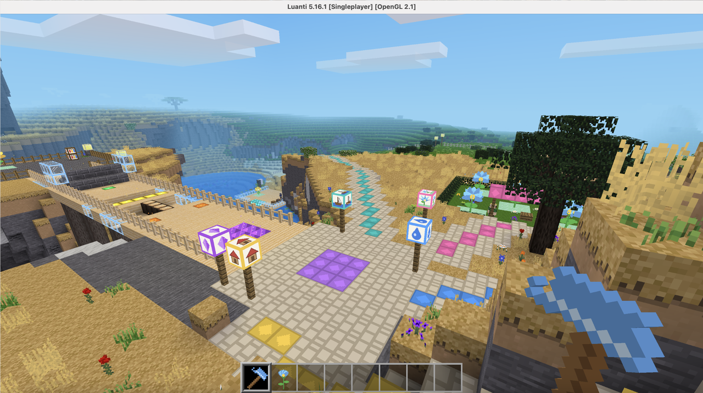

---

## Background

Social learning is part of the Austrian curriculum. The primary
school curriculum defines social learning as a cross-curricular
competence: children should learn with and from others, keep to agreed
rules, take responsibility and resolve conflicts constructively
(BMBWF, 2024).

The activities are designed against established frameworks:

- the competence model for *Social and Personal Competencies* of the
  Austrian ministry (BMUKK, 2011): every activity targets specific
  "can-do statements" (descriptors), see [Learning goals](#learning-goals);
- the five core competencies of CASEL (self-awareness,
  self-management, social awareness, relationship skills, responsible
  decision-making) and the social, emotional and behavioural (SEB)
  skills of the BESSI framework (Soto et al., 2022), which treat social
  skills as abilities that can be practised, not fixed traits;
- the SAFE principles of effective SEL programmes (Durlak et al.,
  2011): the activities are *sequenced* (getting started → calming down →
  cooperating → deciding together), *active* (children practise instead of
  listening), *focused* and *explicit* (each activity targets named
  skills).

Why Luanti? The intervention was first planned for Minecraft
Education Edition. SEL Island uses [Luanti](https://www.luanti.org)
instead, because it is:

- free and open source: no licences, no accounts, no personal data;
- independent of the internet: the class plays on the school network;
- fully programmable: every structure is built by code, so the world
  is exactly the same for every class, and the rules (for example, who
  may dig where) can be shaped to the activities;
- light: it runs on older school computers.

---

## The world

Luanti worlds are either generated at random or from a fixed seed, which
always produces exactly the same landscape. To give every class the same
experience, SEL Island always uses the seed **`sel_island`** (map generator
v7, no dungeons). The game sets this automatically, so the teacher does not
have to type anything.

To find a good place without travelling through the game, the map was first
explored with [Amidst for Minetest](https://github.com/Treer/Amidst-for-Minetest),
which shows a world's landscape from its seed without generating it in the
game. The chosen spot is a lake with a small island around the coordinates
x −680, z −750: the Hub stands on the island, and the activities lie
around the lake. The exact positions were then checked in the generated
game world.

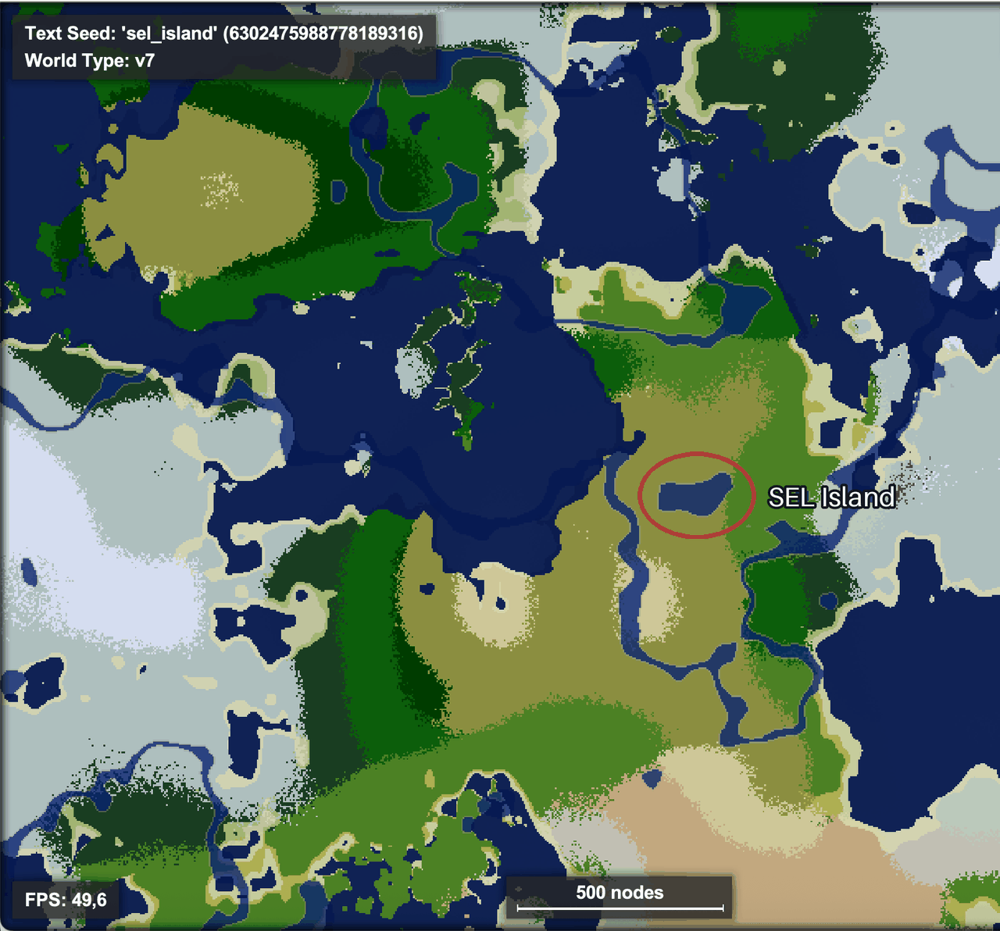

Every structure is built by the game's own code when the world starts:
the Hub, paths, villages and fields always look exactly the same, in every
world and for every class.

---

## The activities

All activities are reached from a crossroads at the end of the
tutorial. Each one has a signpost with a picture and a glowing path
in its own colour, so children only need to follow the colour. Every
story character "speaks" in a short strip of pictures that appears when
a child walks up to them. Recorded voices will be added later; the
pictures will stay.

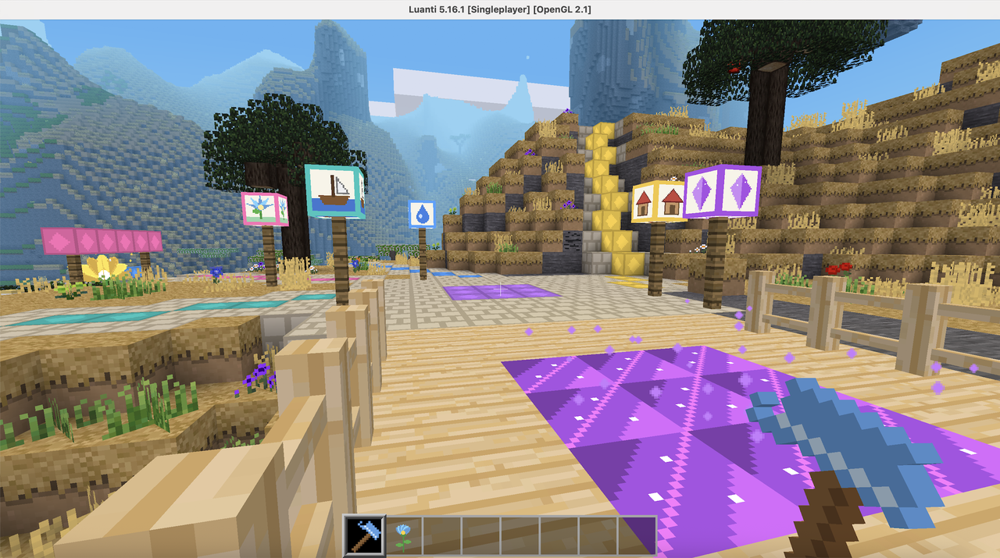


### 1. Tutorial and Hub
Every game starts on the Hub, a plaza on the lake island. A short course
over a bridge teaches the basics: walking, jumping, climbing, a little
parkour, mining and placing blocks, and standing on something *together*
with another child. At the end, every child receives a Builder's Tool
and their own Breathing Flower. At a wardrobe on the plaza,
children can choose how their character looks.

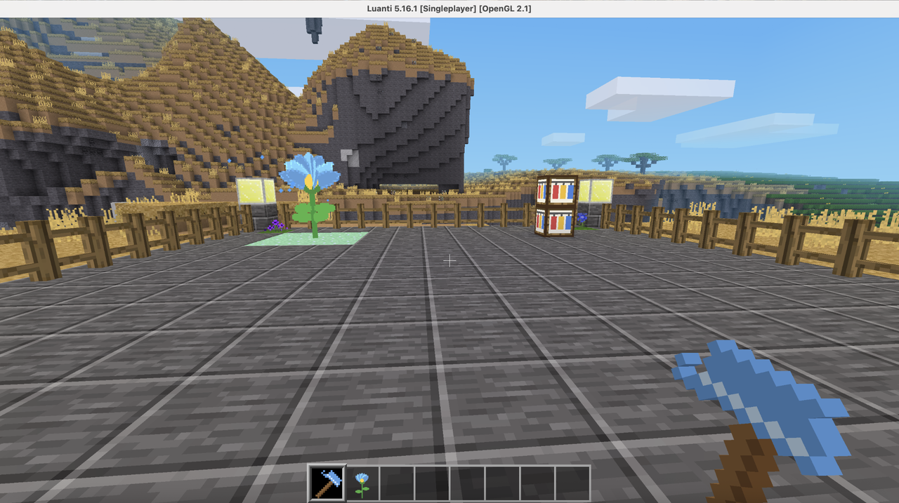

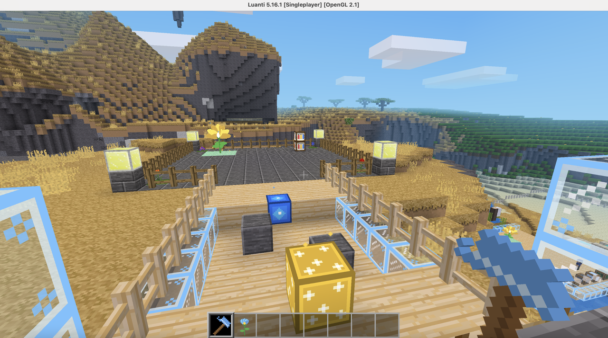

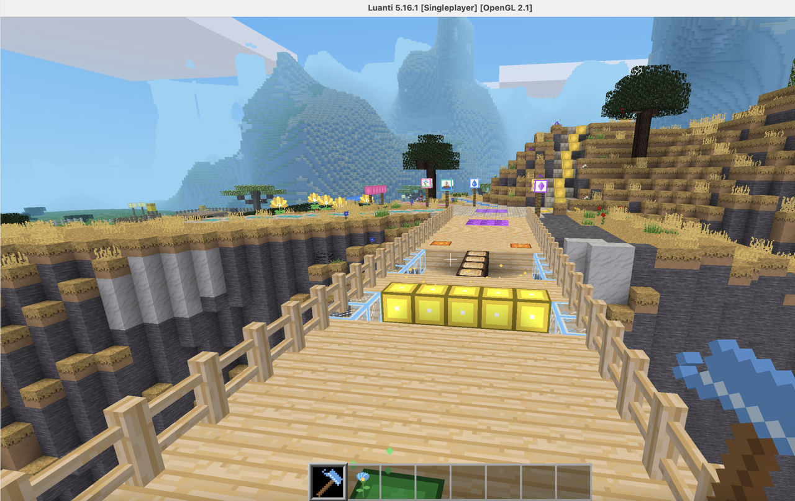

### 2. Breathing Garden
A quiet garden beside the crossroads, full of large flowers that open and
close in a 4-7-8 breathing rhythm. Each phase has its own colour:

| Flower | Colour | Children |
|---|---|---|
| opens (4 seconds) | **blue** | breathe **in** |
| stays open (7 seconds) | **gold** | **hold** their breath |
| closes (8 seconds) | **violet** | breathe **out** |

The Gardener shows in five pictures how to breathe with a flower. The
goal is to learn a grounding technique for moments when something becomes
too overwhelming.

The same flowers stand in a calm corner at every activity, so a child
can always step away and breathe. Every child also carries their own
flower and can plant it wherever they like.

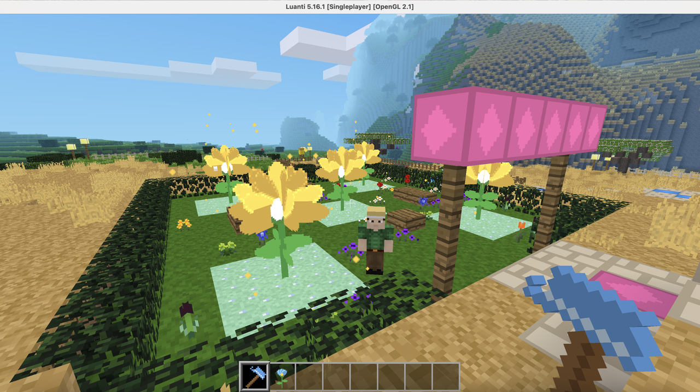

### 3. Lake Crossing
The first cooperative puzzle. At the lake the children meet a
Ferrymaster whose ferry is broken. They have to cross the water
together by building something from the dock: a bridge, a raft, a row of
platforms, whatever they agree on.

- There are four materials: wood, stone, glass and leaves. The game
  gives each child one material, and only that child can take it from
  its crate and place it. If a material has nobody, it is free for
  everyone.
- The structure must contain all four materials and reach at least
  five blocks out over the water. So everyone has to contribute.
- When they think it is ready, all children stand on the launch platform
  together for 3 seconds. If anyone steps off, the count starts again.
- Then the whole structure sails across the lake with the children on
  it.

A child who does not want to join in holds up the whole group. The others
have to talk with them and find a solution together.

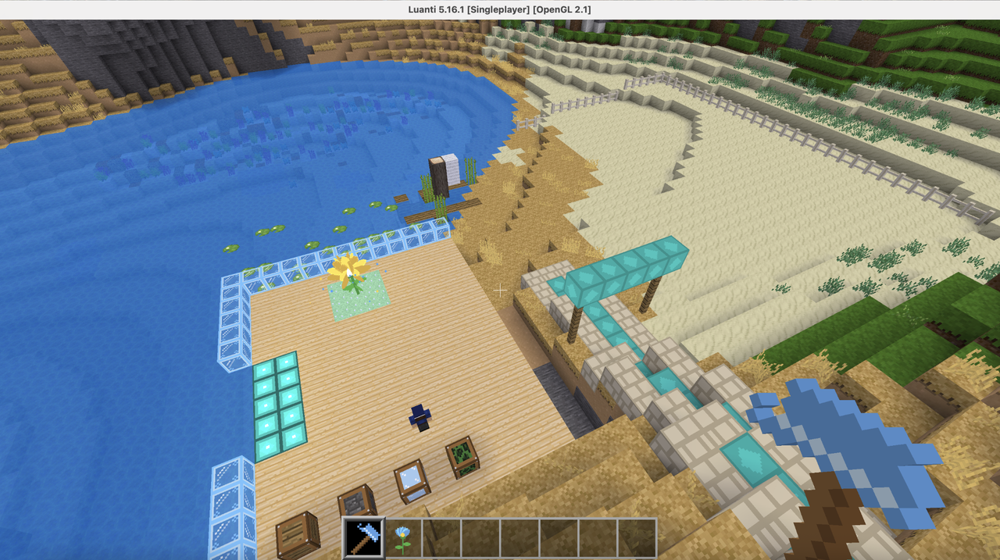

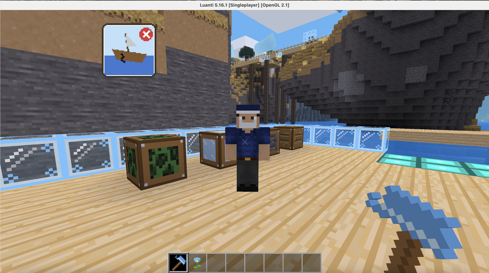

### 4. Village Decision
The children come to a village where glowing gemstones lie scattered
around. The gems only glow for young hands, so only the children can
collect them. Then they hear two stories:

- The Mayor: the village wants to decorate its square with the gems, to
  become the most beautiful village in the region.
- A child of the village: with the gems the broken bridge to their
  grandparents' house could be finished. Without it, the grandparents have
  to take a very long way round, which is hard at their age.

There is no right answer: both choices are good, they just mean different
things.

1. Every child must hear both stories first (two small faces on screen
   show who has heard what).
2. The class discusses, led by the teacher.
3. To decide, all children stand on the Decision Stone together for 3
   seconds. One child who disagrees can simply stay off it, and the group
   cannot go around them.
4. Placing a gem on the gold pedestal (decorate the village) or the
   blue pedestal (finish the bridge) locks the choice.
5. Together they build it: 12 lamps around the square, or the missing
   part of the bridge. Both endings are celebrated.

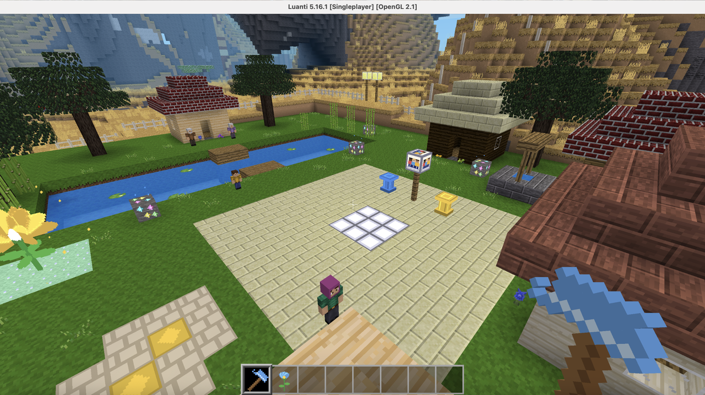

### 5. Irrigation Channel
The children find a dry vegetable and flower garden. Next to a small pool
with a blue Water Source stands an Inventor. She has invented
channel blocks and pumps: the children have to lead the water from the
source to the garden.

- Every child receives 15 channel blocks and one pump. That is not
  enough to reach the garden alone: the children have to combine their
  pieces. A spare-parts crate gives a few more blocks to anyone who has
  run out, so small groups can still finish.
- Boulders and an old tree block the straight way, so the route has to
  be planned together: around, or over.
- Every child builds their own pump into the channel. When it is
  ready, everyone stands on their own pump at the same time for 3
  seconds.
- The water runs as far as the channel goes. If there is a gap, it stops
  there and the children can see where to fix it. If the channel is
  complete, the garden blooms and the dry half of the field turns green.

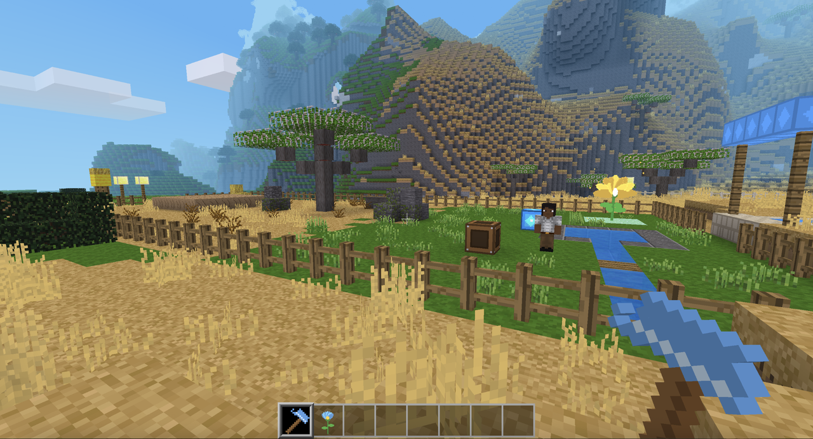

---

## Learning goals

Each activity applies a proven classroom method and targets descriptors
of the BMUKK (2011) competence model (letter = level: C = applying,
D = analysing/evaluating).

| Activity | Method | Competence field | Descriptors |
|---|---|---|---|
| Tutorial and Hub | technical onboarding, then free exploration outside the fence | – | – |
| Breathing Garden | mindfulness and breathing awareness (4-7-8) | self-responsibility, learning and working behaviour | 8.1-C-3, 7.1-D-3, 7.4-D-3 |
| Lake Crossing | cooperative learning after the *Jigsaw* method: every child holds one material nobody else has (positive interdependence) | cooperation | 3.1-C-1, 3.2-C-2, 3.4-C-2 |
| Village Decision | discussion of a social dilemma: two equally valid interests, one shared decision | cooperation, conflicts | 3.3-C-1, 4.1-C-1, 4.3-C-2, 4.3-C-3 |
| Irrigation Channel | shared planning and acting at the same moment | cooperation, communication | 3.1-C-1, 3.4-C-2, 2.1-C-1 |

What the descriptors mean:

| Descriptor | "I can …" |
|---|---|
| 2.1-C-1 | … express myself clearly and distinctly. |
| 3.1-C-1 | … bring my own resources and competencies into the collaboration. |
| 3.2-C-2 | … take on tasks and responsibilities corresponding to my role. |
| 3.3-C-1 | … apply strategies to develop a consensus. |
| 3.4-C-2 | … coordinate my behaviour in the work process with others towards the common goal. |
| 4.1-C-1 | … clearly present my own point of view. |
| 4.3-C-2 | … deal constructively with my own and others' interests and needs. |
| 4.3-C-3 | … develop a solution together with the conflict partners. |
| 7.1-D-3 | … reflect on my attitudes, stances, feelings, values and needs. |
| 7.4-D-3 | … critically engage with my health-promoting and health-endangering behaviour. |
| 8.1-C-3 | … apply effective stress management strategies for myself. |


---

## Roles

The game has two roles.

The teacher has extra rights and a set of chat commands (all starting
with `/sel`) to guide the class, for example:

| Command | What it does |
|---|---|
| `/sel goto <activity> all` | Bring the whole class to an activity |
| `/sel lake_reset` (and similar) | Reset an activity for the next group |
| `/sel calm <name>` | Bring a child to the nearest Breathing Flower |
| `/sel child` | Play as a child, to try everything out |
| `/sel` | List all commands |

The children cannot destroy anything that belongs to the story: they
can only use the blocks an activity gives them, plus their own flower.

---

## The story area and free play

All activities lie inside one story area, surrounded by a white
fence. Inside it, the world stays as it is for every group. Children can
only use what the activities ask for, and plant their own Breathing
Flower.

The fence has several openings, and every child is free to leave and
explore. Outside the fence the world is open: children can mine and build
whatever they like. The lake and a high cliff form natural borders where
there is no fence.


---

## Inclusion

SEL Island is played by whole classes: girls and boys, children with
different first languages, family backgrounds, religions and skin colours,
children who play games every day and children who never have. The game
should feel like "this is for me" to as many of them as possible.

### 1. No reading or listening required
Everything children need is shown with pictures, colour, light and sound.
A child who has just arrived in Austria and speaks no German can play
exactly like everyone else. Text exists only for the teacher (commands and
item names, in English and German).

### 2. Nobody wins, nobody is left out
- There are no scores, timers, rankings or eliminations, so there is no way
  to be "the worst". The group succeeds together, or finds out together
  why not.
- Roles (Lake Crossing) are handed out by the game, evenly and without
  regard to who the child is. Nobody is "the builder" or "the gardener"
  because of being a boy or a girl. All four roles are needed equally.
- Every "everyone together" moment waits for every child. A quiet or
  hesitant child has the same weight as a loud one.

### 3. Children choose how they look
Luanti's basic game gives everyone the same character. SEL Island has
**eight looks** with different skin tones, hair and clothes:

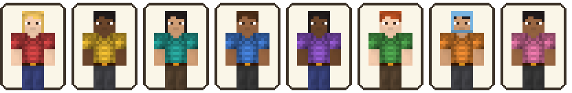

- A new child gets one automatically (spread across the class). The look
  with a headscarf is never given automatically: it is only ever chosen.
- At the wardrobe on the Hub plaza, a right click changes to the next
  look. No look is labelled "boy" or "girl", and clothes colours are mixed
  on purpose (for example, pink and purple are not tied to long hair).
- One look wears a headscarf, so that children who wear one, or whose
  mothers and sisters do, also find themselves in the game.

### 4.  Mixed cast of story characters
The people children meet are deliberately different from each other:

| Character | Who |
|---|---|
| Ferrymaster | an older man, tan skin, white beard |
| Inventor | a woman, dark skin, long black hair, lab coat |
| Gardener | a young man, light skin, straw hat: the one who teaches calming down |
| Mayor | a woman with a headscarf |
| Village child and grandparents | one family, brown-skinned; the grandmother has long grey hair, the grandfather a grey beard |

So the expert and the person in charge are women, the one who shows how to
calm down is a man, and no group appears only as "the one who needs help".

---

## Installation

1. Install Luanti 5.9 or newer from [luanti.org](https://www.luanti.org).
2. In Luanti, open the About tab and click Open User Data Directory.
3. Copy the `sel_island` folder into the `games` folder there. (When
   updating, delete the old `sel_island` folder first.)
4. Restart Luanti and select SEL Island (island icon at the bottom).
5. Click New, give the world a name and start it. Seed and map
   settings are applied automatically; the first start builds everything
   (a few seconds).

To play as a class, the teacher hosts the world ("Host Server") and the
children join it. Whoever hosts automatically has the teacher rights;
another adult can be given them with `/grant <name> sel_teacher`.

---

## For developers

```
sel_island/
├── game.conf, minetest.conf   game definition and default settings
├── mods/
│   ├── mtg/                   the Minetest Game mods needed (unmodified)
│   └── sel/                   SEL Island: sel_core (shared library),
│                              sel_hub, sel_flower, sel_lake, sel_village,
│                              sel_irrigation, sel_looks
└── docs/                      documentation
```

- All pictures and sounds were generated by a script; no external art is used.
- All positions and numbers of an activity are in its `config.lua`.

---

## Use of AI tools

The game's code, documentation and generated media were developed with the help of Claude (Anthropic), an AI assistant, based on the author's design (the original activity descriptions) and continuous testing and feedback. The author reviewed, adapted and takes full responsibility for all content.

---

## Licence

- **SEL Island** (code, documentation and its own pictures and sounds):
  [MIT License](LICENSE).
- **Minetest Game** (`mods/mtg/`): the basic world, blocks and player
  model, by the Minetest Game contributors. Code under LGPL 2.1+, media
  under CC BY-SA 3.0. Some SEL textures are built on Minetest Game
  textures and keep CC BY-SA 3.0.

---

## References

BMBWF. (2024). *Lehrplan der Volksschule.*
https://www.ris.bka.gv.at/NormDokument.wxe?Abfrage=Bundesnormen&Gesetzesnummer=10009275&Anlage=1

BMUKK. (2011). *Broschüre Bildungsstandards: Soziale und personale
Kompetenzen (9.–13. Schulstufe)* (U. Zug, Ed.). Bundesministerium für
Unterricht, Kunst und Kultur.

Durlak, J. A., Weissberg, R. P., Dymnicki, A. B., Taylor, R. D., &
Schellinger, K. B. (2011). The impact of enhancing students' social and
emotional learning: A meta-analysis of school-based universal
interventions. *Child Development, 82*(1), 405–432.

Soto, C. J., Napolitano, C. M., Sewell, M. N., Yoon, H. J., & Roberts,
B. W. (2022). An integrative framework for conceptualizing and assessing
social, emotional, and behavioral skills: The BESSI. *Journal of
Personality and Social Psychology, 123*(1), 192–222.
https://doi.org/10.1037/pspp0000401
