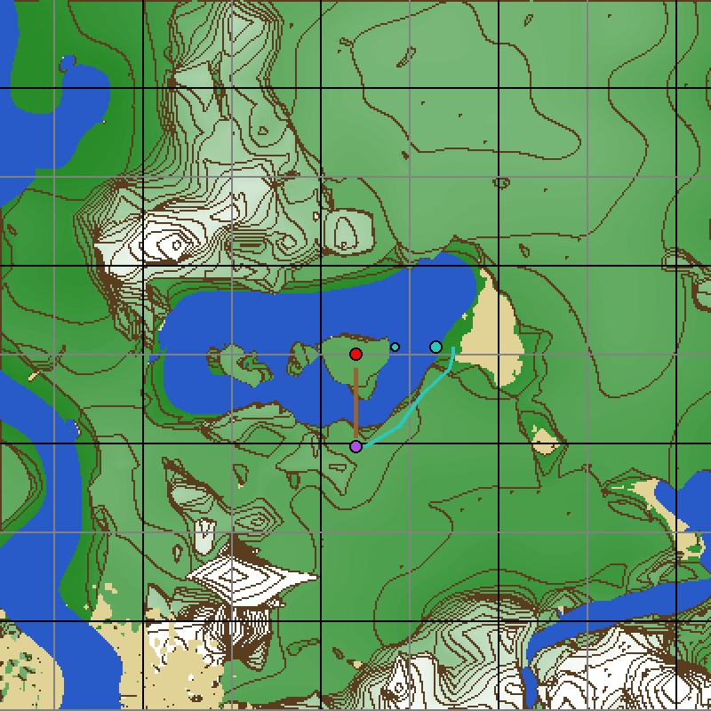
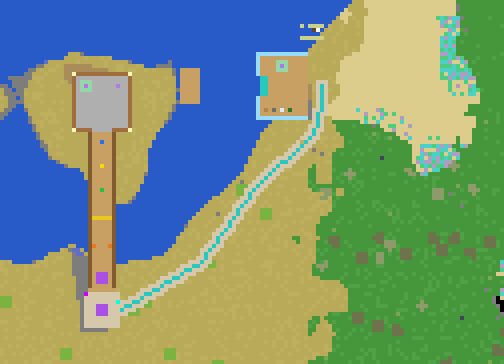
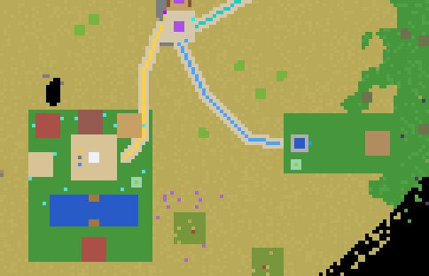
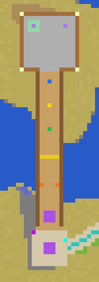
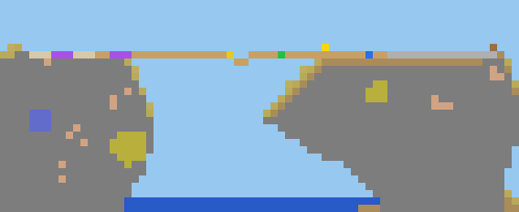

# The World

## Settings

| Setting | Value | Where it is enforced |
|---|---|---|
| Mapgen | v7 | `game.conf` (`allowed_mapgens`), `sel_core/world.lua` |
| Seed | text `sel_island` = number `6302475988778189316` | `sel_core/world.lua` |
| mg_flags | `caves, nodungeons, light, decorations, biomes, ores` | `sel_core/world.lua` |
| mgv7_spflags | `mountains, ridges, nofloatlands, caverns` (engine defaults) | `sel_core/world.lua` |
| Spawn | `-680, 22, -750` (Hub plaza centre) | `minetest.conf` (`static_spawnpoint`) |
| Time | always noon | `minetest.conf` (`time_speed = 0`) + `world.lua` |

**Why the number?** Luanti turns a text seed into a number with a hash
(`read_seed()` in the engine). `core.set_mapgen_setting("seed", …)` only
accepts numbers, so we stored the number that Luanti itself produced for
`sel_island` (verified: a world created with the text seed has exactly this
seed in its `map_meta.txt`).

The settings are applied with "override", so even a world created with
another seed in the main menu becomes the SEL world on its first start.
Never load an *old, already explored* world with a different seed into this
game — the new terrain would not fit the old one.

## The place: a lake with an island

Martin Guevara-Kunerth chose the spot around (−680, −751) after exploring the
world. It is a lake about 180 × 90 blocks in a grassy savanna
basin, with a flat-topped island in the middle — the real "SEL Island".

Map from x −880…−481, z −950…−551, 2 pixels per block, **north is up**.
Blue = water, green→white = low→high, sand = beach, brown contour lines
every 5 blocks of height, grid every 50 blocks (black every 100).
Red dot = Hub, brown line = tutorial walkway/bridge, purple dot =
crossroads, teal line = path to the Lake Crossing, teal dots = its docks.

* **Hub island:** flat plateau at y 21, about x −698…−662, z −766…−742,
  with cliffs down to the water (surface at y 1).
* **South shore:** flat ground at y 20–22 → the crossroads.
* **East beach:** wide, flat sand at y 2–3 (x −630…−596, z −752…−726) →
  the Lake Crossing start dock.
* **Fields:** flat ground at y 14–15 south-east of the crossroads
  (x −652…−604, z −848…−822) → the Irrigation Channel.
* **Village ground:** flat at y 19–20 south-west of the crossroads
  (x −722…−688, z −851…−827), behind a small hill, at the foot of a very
  high mountain (it starts at about x −705, z −869 and rises to y 185).
* More islands to the west (x −760…−705), hills north-west and south.

Everything built so far, from above (north up, 4 px per block).

## Fixed coordinates

| What | Position | Defined in |
|---|---|---|
| Hub origin (plaza floor centre) | −680, 21, −750 | `sel_hub/config.lua` |
| Hub plaza | x −687…−673, z −757…−743, floor y 21 | `sel_hub/config.lua` |
| Hub calm corner | −684, 21, −746 (grass patch centre) | `sel_hub/config.lua` |
| Tutorial walkway (also the bridge to the shore) | x −683…−677, z −758…−797, floor y 21 | `sel_hub/config.lua` |
| Crossroads (9 × 9) | centre −680, 21, −802 | `sel_hub/config.lua` |
| Crossroads exits (path starts) | east (−675, −802) · south (−680, −807) · west (−685, −802) | `sel_hub/config.lua` |
| Hub protected zone | x −689…−671, y −39…41, z −799…−741 | `sel_hub/config.lua` |
| Lake start dock / launch platform | x −640…−629, z −753…−739, y 2 / x −640…−639, z −748…−744 | `sel_lake/config.lua` |
| Lake far dock (at the Hub island) | x −660…−656, z −750…−742, y 2 | `sel_lake/config.lua` |
| Lake calm corner | −635, 2, −741 | `sel_lake/config.lua` |
| Ferrymaster | −634, 2.5, −750 | `sel_lake/config.lua` |
| Irrigation field (fenced, ground y 15; green west, dry east) | x −650…−606, z −846…−824 | `sel_irrigation/config.lua` |
| Water Source block / garden bed | (−643, 16, −835) / x −618…−612, z −838…−832, y 16 | `sel_irrigation/config.lua` |
| Irrigation calm corner / Inventor | (−647, 15, −841) / (−644, 15.5, −830) | `sel_irrigation/config.lua` |
| Blue path (crossroads → field) | (−680,−807) → (−672,−822) → (−660,−834) → (−652,−835) | `sel_irrigation/config.lua` |
| Village ground (level, y 19) / square | x −722…−688, z −868…−826 / x −710…−698, z −845…−833 | `sel_village/config.lua` |
| Decision Stone / pedestals | x −705…−703, z −840…−838 / (−708, 20, −837) gold, (−708, 20, −841) blue | `sel_village/config.lua` |
| Village pond / bridge gap | x −716…−692, z −858…−850 / x −705…−703, z −856…−852 | `sel_village/config.lua` |
| Village calm corner | −692, 19, −846 | `sel_village/config.lua` |
| Gold path (crossroads → village) | (−685,−802) → (−690,−815) → (−690,−833) → (−695,−839) | `sel_village/config.lua` |
| **Story area** (no digging for children; white fence on its border) | x −727…−598, z −873…−724 | `sel_core/story_area.lua` |
| Fence openings | east (−598, z −836…−834 and −790…−788), south (x −652…−650 and −690…−688, z −873), west (−727, z −861…−859) | `sel_core/story_area.lua` |
| Breathing Garden (ground y 19) / Gardener | x −665…−651, z −818…−804 / (−663, 19.5, −809) | `sel_flower/config.lua` |
| Pink path (crossroads → garden) / signpost | (−675,−807) → (−667,−811) / (−673, −805) | `sel_flower/config.lua` |
| Wardrobe (looks) on the Hub plaza | −676, 22, −746 (two blocks high) | `sel_hub/config.lua` |
| Gates over the paths: teal / blue / gold | (−625, −750) / (−651, −835) / (−690, −826) | `gate` in each site's `config.lua` |
| Irrigation obstacles: boulders / old tree | around (−635, −835) and (−623, −836) / (−627, −837) | `sel_irrigation/config.lua` |
| Spare-parts crate (irrigation) | −642, 16, −829 | `sel_irrigation/config.lua` |
| Village well / apple trees | (−714, −835) / (−720,−836), (−690,−856), (−712,−864), (−695,−864) | `sel_village/config.lua` |
| Crossroads: flower meadow (radius 11), apple trees | trees at (−672, −812) and (−694, −806) | `sel_hub/config.lua` |
| Hub plaza flower planters | (−686 / −674, 21, −756 / −744) | `sel_hub/config.lua` |
| Lake: reeds and water lilies | x −642…−623, z −737…−731 and x −642…−628, z −762…−756 | `sel_lake/config.lua` |
| Teal path (crossroads → lake) | (−675,−802) → (−655,−790) → (−642,−772) → (−627,−758) → (−625,−746) | `sel_lake/config.lua` |

Paths and their colours:

| Colour | Leads to | Crossroads exit | Status |
|---|---|---|---|
| purple | Hub (crystal sign) | north (the walkway) | built |
| teal | Lake Crossing (boat sign) | east | built |
| blue | Irrigation Channel (water-drop sign) | south | built |
| gold | Village Decision (house sign) | west | built |

Everything south of the crossroads, from above (north up, 4 px per block):
the village on the left with the gold path, the irrigation field on the
right with the blue path.

Hub from above (plaza on the island at the top, walkway going south across
the water to the crossroads) and a side cut through x = −680 (south on the
left).

## History

The first version had the Hub on a hill at (31, 68, 18) near
the world origin and the Lake Crossing at a sea channel north of it. Both
were later moved to the lake. Worlds created with the old version
keep those old (snowy) buildings, but players are brought to the new Hub
automatically when they join (`sel_hub.LOCATION_VERSION`). A **new world**
gives a clean result.

