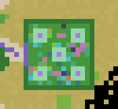
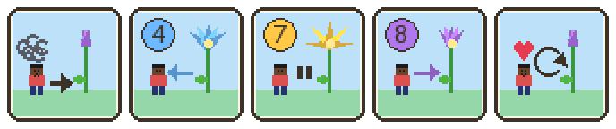

# Activity 2 — Breathing Flower (`sel_flower`)

**Status:** implemented, automated tests pass. Needs a real playtest
(how it looks from different angles, whether the sparkles feel calm).

## Goal

The teacher places a flower anywhere. Children gather around and breathe
with it — no buttons, no commands. 4 s opening (breathe in), 7 s open
(hold), 8 s closing (breathe out). Blue sparkles drift out, hover, settle
back. It closes into a bud, never wilts, and keeps going until removed.

## How it works

* The flower is a **block with 5 looks** (stage 0 = bud … 4 = wide open),
  drawn 3 blocks tall in a star shape so it looks round from every side.
* It also has a **colour per phase**, so children see what to do:
  **blue** = breathe in, **gold** = hold, **violet** = breathe out.
  (11 blocks: in 0–4, hold 4, out 0–4; the sparkles use the same colour.)
* A **node timer** ticks every 0.25 s. It adds the time to the flower's own
  clock (node metadata `t`, 0…19 s) and computes:
  * the phase — `in` (0–4 s), `hold` (4–11 s), `out` (11–19 s)
  * the openness — 0→1 during `in`, 1 during `hold`, 1→0 during `out`
  * the stage — openness × 4, rounded
* If the stage changed, the block is swapped (`core.swap_node` keeps the
  clock and the timer).
* Every tick a small particle spawner adds blue sparkles for the phase:
  | Phase | Sparkles |
  |---|---|
  | in | start at the flower head, drift outward |
  | hold | appear in a cloud around the flower, float almost still |
  | out | appear in the cloud and are pulled back into the head (`attract`) |

Because the clock lives in the block, the flower survives server restarts
and several flowers run independently.

## Design decisions

| Decision | Why |
|---|---|
| Node with 5 textures instead of an animated 3D model | KISS: no model files, works on every client |
| Colour changes with the phase (blue / gold / violet) | Martin Guevara-Kunerth's playtest: "hold" was not recognisable from the shape alone |
| Breathing in is shown in 1-second steps, out in 2-second steps | Matches 4 and 8 seconds with the same 5 looks |
| **Every child owns one flower** (given with the Builder's Tool after the tutorial, returned on rejoin if missing) and can plant it and pick it up again | Martin Guevara-Kunerth: children should be able to place flowers — a calm moment wherever they need it |
| Flowers of calm corners are "fixed" (node meta `fixed = 1`): only the teacher can remove them | The permanent calm places must not disappear |
| Collision only around the stem | Children can stand close, inside the petals |
| No sound | Breathing should be calm; the teacher can count aloud |
| Glows (light 8) | Visible in caves or at night if time is ever enabled |

## Files

| File | Content |
|---|---|
| `config.lua` | IN/HOLD/OUT times, number of stages, tick, size, head height |
| `flower.lua` | Breathing maths, sparkles, the 5 blocks |
| `calm.lua` | Calm Grass, calm corner builder, list of all flowers, `/sel_calm` |
| `commands.lua` | `/sel_flower` |
| `locale/sel_flower.de.tr` | German strings ("Atemblume") |
| textures | `sel_flower_in_0..4.png`, `sel_flower_hold_4.png`, `sel_flower_out_0..4.png`, generated by a script |

## The Breathing Garden (`garden.lua`)

A place to LEARN the flower, and to come back to. It lies a few steps
south-east of the crossroads; a short **pink path** with a flower signpost
leads through a pink gate in the hedge.

Top view, north up: hedge (dark green) with the entrance and pink gate on
the left, five patches of Calm Grass with a Breathing Flower each, small
flowers and seats between them.

The **Gardener** (a young man with a straw hat) tells how it works in
five pictures (no words):

1. When everything is too much: go to a flower.
2. The flower opens, **blue** → breathe **in**, 4.
3. The flower is open, **gold** → **hold**, 7.
4. The flower closes, **violet** → breathe **out**, 8.
5. Calm again — and again, as often as you like.

| What | Where |
|---|---|
| Garden, 15 × 15, ground y 19, hedge around it | x −665…−651, z −818…−804 |
| Entrance (west hedge) and pink gate | x −665, z −812…−810 |
| Five Breathing Flowers (centre of each Calm Grass patch) | (−658, −811) and (−662 / −654, −815 / −807) |
| Gardener | (−663, 19.5, −809) |
| Seats (wooden slabs) | north, south, east and west of the middle flower |
| Butterflies | four, two blocks above the beds |
| Pink path from the crossroads' south-east corner (≈ 10 blocks) | (−675, −807) → (−667, −811) |
| Signpost (flower picture) | (−673, −805) |
| `/sel goto garden` arrival | (−664, 20, −811) |

| Decision | Why |
|---|---|
| Right beside the crossroads, not at the end of a long path | Every child passes it on the way to any activity; it is the one place that should always be near |
| Five flowers that breathe together | A whole class finds room; seeing several flowers in the same rhythm makes the rhythm obvious |
| The pictures show the three COLOURS and the counts 4-7-8 | The colours are what children see on the real flower; digits are known to all 9-year-olds regardless of language |
| The garden's flowers are fixed (like calm corners) | Nobody can carry the garden away; `/sel calm` finds them |
| No rules of its own: the story area protects it | KISS — children cannot dig there anyway and may plant their own flower |

Rebuild: `/sel garden_rebuild`. Positions: `sel_flower.garden` in
`config.lua`; version `sel_flower.GARDEN_VERSION`.

## Calm corners (every activity)

Every activity site has a permanent **calm corner**: a 3×3 patch of light
mint-green *Calm Grass* (unbreakable) with a Breathing Flower in the middle.
It always looks the same, so children learn once: *green patch + big
flower = a calm place to breathe*. Built with
`sel_flower.build_calm_corner(pos)` from each activity's `build.lua`.

| Site | Calm corner (centre of the grass patch) |
|---|---|
| Hub | (−684, 21, −746) — north-west part of the plaza |
| Lake Crossing | (−635, 2, −741) — north end of the start dock |
| Irrigation Channel | (−647, 15, −841) — south-west corner of the field |
| Village Decision | (−692, 19, −846) — south-east of the square |

All flowers (calm corners and teacher-placed) are remembered, so
`/sel_calm <name>` brings a child to the nearest one.

## Children's own flowers

After finishing the tutorial every child has a Breathing Flower in the
inventory. Right-click the ground to plant it, dig it to take it along
again. It can be planted anywhere in the story area (it is the one thing
children may place there) and of course outside the fence — only not on
the Hub course and the docks.

## Teacher use

1. `/sel_flower` → a flower appears in your inventory.
2. Select it and right-click the ground where the class should gather.
3. To remove it: dig it (left click) or use the Teacher's Wand.

## Ideas for later

* Optional soft sound at the start of each breath.
* A "slower" variant for younger groups (only change `config.lua`).
