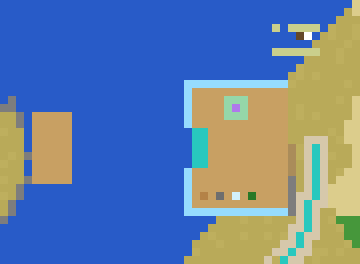
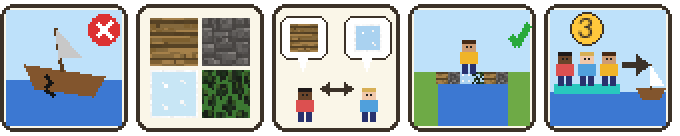

# Activity 3 — Lake Crossing (`sel_lake`)

**Status:** all three steps implemented; automated tests pass. Needs a real
playtest with several children (roles and sailing cannot be judged alone).

| Step | Content | Status |
|---|---|---|
| 1 | Site: docks, launch platform, crates, Ferrymaster + picture story, broken ferry, calm corner, teal path | ✅ |
| 2 | Material roles (Wood / Stone / Glass / Gardener), dig/place/crate rules, free roles for small groups | ✅ |
| 3 | Launch: everyone on the platform 3 s, vessel check, sailing, fireworks, way back | ✅ |

## How it plays

1. Children follow the teal path to the beach. Entering the **activity
   area** (both docks, the water between, a bit of beach) gives each child
   one **material role**, handed out evenly. Four pictures in the top left
   corner show the materials: bright = yours (or free), dark = ask someone.
2. The Ferrymaster's five pictures explain the task.
3. Each child can only take, place and dig **their own material**. Trying
   anything else: nothing happens. They have to talk.
4. They build from the teal **launch platform** out over the water.
5. When they agree it is finished, **all children in the area** stand on
   the launch platform for **3 seconds** (big 3-2-1). Someone steps off, or
   one child is still elsewhere in the area → the count starts over.
6. The game checks the **vessel** = every material block connected to the
   launch platform:
   * at least one block of **each** of the four materials, and
   * it reaches at least **5 blocks** out over the water.
   If not: a picture shows what is missing (all-materials picture + the
   crates of the missing materials sparkle, or the build-across picture),
   and they keep building. This is meant to happen.
7. If it is fine: the children are put on the vessel and it **sails** west,
   block by block, until it touches the far dock at the Hub island.
8. Fireworks. A purple **home pad** appears on the far dock — stepping on
   it brings a child back to the Hub.

The teacher prepares the next group with **`/sel lake_reset`** (removes
the vessel, the home pad and all roles).

## The site

The crossing goes over the lake around the Hub island: from the sandy east
beach westwards to the foot of the island (see `docs/WORLD.md`).

Top view, north up: far dock at the island (left), open water, start dock
with the teal launch platform, crates and calm corner (right), the teal
path arriving from the south, the broken ferry at the top.

| What | Where |
|---|---|
| Start dock, pine deck y 2 (level with the beach) | x −640…−629, z −753…−739 |
| Launch platform (teal, glowing) | x −640…−639, z −748…−744 — the west railing is open only here |
| Crates: wood, stone, glass, garden | z −752, x −639 / −637 / −635 / −633 |
| Ferrymaster | (−634, 2.5, −750) |
| Calm corner | centre (−635, 2, −741) |
| Open water to cross | x −655…−641 (15 blocks) |
| Far dock (goal) at the Hub island's east cliff | x −660…−656, z −750…−742 |
| Broken ferry (decoration) | x −630…−625, z −734…−731 |
| Teal path from the crossroads (≈ 65 blocks) | ends on the beach at (−625, −746) |
| Teal gate over the path (site version 4) | (−625, −750) |
| Reeds and water lilies (decoration) | beside the dock: x −642…−623, z −737…−731 and x −642…−628, z −762…−756 — never in the water between the docks |
| `/sel_goto lake` arrival | (−636, 3, −746) |

## The Ferrymaster's picture story

1. The ferry is broken.
2. Here are materials: wood, stone, glass, leaves.
3. Talk and share what you have.
4. Build something across the water — any shape.
5. Everyone on the launch platform, count 3 → it sails.

The panels appear one by one when a child comes within 6 blocks (uses
`sel_core/npc.lua`). They are meant to stay when voices are added later.

## Protection

* Dock decks and the ferry: protected zones (cannot be dug).
* Crates, launch platform, railing, calm grass: unbreakable blocks.
* Inside the activity area children can only dig and place their own
  material (and plant their own Breathing Flower).

## Design decisions so far

| Decision | Why |
|---|---|
| Docks leave 15 blocks of open water | Enough work for a group, not tedious |
| The far dock is at the Hub island | Crossing the lake brings the children "home"; step 3 adds the way up |
| Shield Glass railing, open in front of the launch platform | Shows *where* to build from, without words |
| Crates give 10 blocks per right click, unlimited | KISS; scarcity is not the lesson — sharing roles is |
| Gardener crate gives leaves + 2 roses | "Leaves and flowers" from the original design |
| Children walk there on the teal path from the crossroads (boat signpost) | They find it themselves; `/sel_goto lake` also works |

## Rules in detail (for developers)

| Rule | Where |
|---|---|
| Area box `area_min` / `area_max`; participant = non-teacher inside it | `config.lua`, `roles.lua` |
| New participant gets the role with the fewest participants (ties: wood, stone, glass, garden). Kept until reset | `roles.lua` `assign_role` |
| `may_use(player, role)`: own role, or a role no participant has, or teacher | `roles.lua` |
| Digging: protected zone over the area; allowed only for material blocks the child may use (and for Breathing Flowers) | `roles.lua` |
| Placing: `on_placenode` undoes a block the child may not use and keeps it in the inventory | `roles.lua` |
| Crates: `on_rightclick` does nothing unless `may_use` | `nodes.lua` |
| Vessel = flood fill (6 neighbours) from the blocks touching the launch platform, over the material blocks, inside the area, max 3000 blocks | `launch.lua` `find_vessel` |
| Sailing = shift all vessel blocks one step west with a VoxelManip every 0.35 s; players are moved along | `launch.lua` |
| State `building → sailing → done` saved in mod storage | `launch.lua` |

## Decided: what sails?

The original design says the vessel is built "from the shore across the water" *and*
that it then "sails across the lake". Implemented as proposed
(agreed with Martin Guevara-Kunerth): the vessel must touch the launch
platform and reach at least `MIN_REACH = 5` blocks out; on launch it sails
the rest of the way. If the children build all the way across, the sail is
just very short. Change `sel_lake.MIN_REACH` to make it stricter.

## Known limitations

* A teacher is not a participant (no role, not needed on the platform).
  To try it alone in singleplayer, use child mode (`/sel child`): one
  child gets one role and the other three materials are free.
* Roses cannot be stood on; they count as garden material but children are
  never placed on them.
* Anything standing on the vessel that is not one of the four materials
  (e.g. a child's Breathing Flower) stays behind when it sails.
