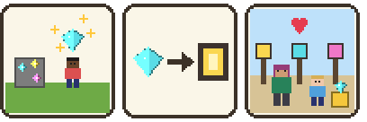
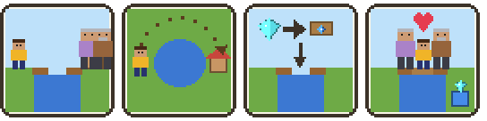
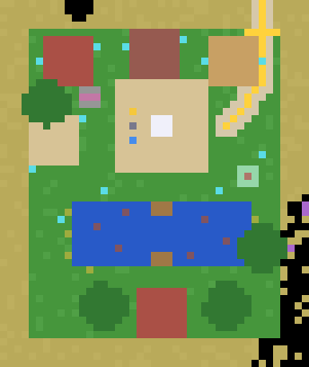

# Activity 4 — Village Decision (`sel_village`)

**Status:** implemented; automated tests pass (both choices are played
through by simulated children). Needs a playtest with a real group — the
heart of this activity is a conversation, which no test can check.

## Goal

A village with sparkling gemstone deposits. The Mayor wants to decorate
the square with them; a child from the village wants to finish the bridge
to the grandparents. The children find gemstones, hear both sides, talk it
out with the teacher, agree by all standing on the Decision Stone, lock
the choice with a gemstone on a pedestal, and then build what they chose.
There is no right answer.

## How it plays

| Step | What the children do | What the game does |
|---|---|---|
| 1 Gather | Follow the **gold path** (house signpost) over the hill to the village. Mine the sparkling **gemstone deposits** hidden around the houses | Deposits grow back after 20 s, so everyone finds some |
| 2 Listen | Walk up to the **Mayor** (where the path arrives) and to the **village child** (at the broken bridge) | Their picture stories appear. Two small faces in the top left corner light up when a child has heard each of them |
| 3 Talk | Discuss in real life, led by the teacher | — |
| 4 Agree | **All** children in the village stand on the white **Decision Stone** for 3 s | 3-2-1. Someone steps off or stays away → no decision. If someone has not heard both sides, that child is shown whom to listen to first |
| 5 Decide | Right-click a **pedestal** with a gemstone in the hand: gold = village, blue = bridge | The pedestals sparkle and wait. The first gemstone fixes the choice for good; a gem appears on that pedestal |
| 6 Build | **Gold:** place gem lamps on and around the square. **Blue:** close the gap in the bridge with planks | Everyone receives the blocks (late-comers too). A row of ten gems on the screen fills up |
| 7 Done | — | Fireworks, a purple home pad on the square. Across the finished bridge the grandparents wait in front of their house |

The teacher prepares the next group with **`/sel village_reset`**.

## The two stories

Mayor — *"Let us make our village beautiful"* (ends with the gold pedestal):

Village child — *"Then I can visit my grandparents every day"* (ends with
the blue pedestal):

Both are told equally warmly: a heart appears in each. The Mayor is not
"the selfish one" and the child is not "the one you must help".

## The site

Top view, north up: four houses around the paved square (white Decision
Stone in the middle, pedestals and picture sign on its west side), the
gold path arriving top right, calm corner right of the square, the pond
with the two bridge ends and the gap, the grandparents' house at the
bottom. Cyan dots = gemstone deposits.

| What | Where |
|---|---|
| Level ground, y 19 | x −722…−688, z −868…−826 |
| Activity area | x −724…−686, y 12…45, z −870…−824 |
| Square (sandstone brick) | x −710…−698, z −845…−833 |
| Decision Stone 3 × 3 | x −705…−703, z −840…−838 |
| Gold / blue pedestal | (−708, 20, −837) / (−708, 20, −841); picture sign between them |
| Mayor / village child | (−699, 19.5, −836) / (−701, 19.5, −848) |
| Pond (water surface one below the ground) | x −716…−692, z −858…−850 |
| Bridge, 3 wide; **gap** 3 × 5 = 15 blocks | x −705…−703; gap z −856…−852 |
| Grandparents' house and the grandparents | x −706…−702, z −867…−863; in front at z −861 |
| 12 gemstone deposits | see `gems` in `config.lua` |
| Calm corner | centre (−692, 19, −846) |
| Home pad (after the celebration) | (−704, 19, −843) |
| Gold path from the crossroads' **west** exit (≈ 38 blocks, over the hill) | (−685,−802) → (−690,−815) → (−690,−833) → (−695,−839) |
| `/sel goto village` arrival | (−696, 20, −839) |
| Decoration (site version 2): gold gate | over the path at (−690, −826) |
| … well | centre (−714, −835) |
| … apple trees | (−720,−836), (−690,−856), (−712,−864), (−695,−864) |
| … two flowers at every door, grass tufts, reeds and water lilies at the pond | see `build_decor` in `build.lua`; no lilies where the bridge will be |

## Design decisions

| Decision | Why |
|---|---|
| The Decision Stone only counts when **every** child has heard **both** sides | "Both sides are needed before anything can be decided" |
| It tells a child *whom* to listen to (a picture), not just "no" | Wordless and helpful instead of a silent failure |
| The pedestals do nothing until the group has agreed | Nobody can rush ahead and decide alone |
| The first gemstone locks the choice; the other pedestal is then dead | A decision is a decision — and the group agreed before |
| Both outcomes get the same fireworks | No "better" ending |
| Everyone receives enough blocks to reach the goal together with two spare; alone it is still possible | Small groups |
| Gold needs 12 lamps anywhere on or around the square; blue needs all 15 gap blocks | "Done when the chosen thing is actually built" — free placement for decorating, an exact task for the bridge |
| The "lake" of the story is a pond next to the village | The real lake is 100 blocks away and has cliffs; the pond keeps the whole story in one place |
| Houses are all different (wood and roof) and belong to no particular style | See the Inclusion section of the README |

## Files

| File | Content |
|---|---|
| `config.lua` | All positions, houses, gem places, goals |
| `nodes.lua` | Gem ore, gemstone, Decision Stone, pedestals (+ lit versions), gem lamps, bridge plank |
| `rules.lua` | Participants, dig/place rules per state, screen icons (faces, gem row) |
| `decide.lua` | State machine, group hold, pedestal click, kits, progress, celebration, reset |
| `npc.lua` | Mayor, village child, grandparents |
| `build.lua` | Ground, path, pond, bridge ends, square, houses, signposts, site, rebuild |

Saved data: mod storage `built_version`, `state`, `round`, `chosen_by`;
player meta `sel_village:kit_round`, `sel_core:heard_mayor`,
`sel_core:heard_village_child`.

## Known limitations

* A teacher is not a participant; use `/sel child` to try it alone.
* The stories are forgotten on reset only for children who are online.
* Nothing checks that each child has mined a gemstone — one gemstone in
  the group is enough to decide.
