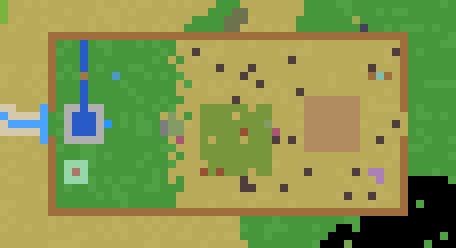
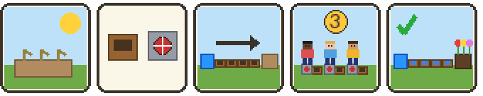

# Activity 5 — Irrigation Channel (`sel_irrigation`)

**Status:** implemented; automated tests pass. Can be tried alone in child
mode (`/sel child`, using the spare-parts crate); needs a playtest with
several children. Site version 2: a bigger, more varied field.

## Goal

The garden is dry. Each child gets 15 channel blocks and one pump station.
Together they build a channel — any shape — from the blue Water Source to
the brown Garden, each child places their own pump along it, and then
everyone stands on their own pump at the same time for 3 seconds. If the
channel is not connected, the water does not arrive and they have to find
the gap together. Done when the water actually reaches the garden.

## How it plays

1. Children follow the **blue path** from the crossroads (water-drop
   signpost) through the **blue gate** onto the field. Walking in hands
   out the **kit**: 15 channel blocks + 1 pump (once per round).
2. The **Inventor** tells the task in five pictures.
3. They build the channel: blocks are connected when they **touch**
   (side by side or on top of each other, so it can climb on posts made of
   channel blocks). It must start next to the blue **Water Source** block
   and end next to the **garden bed**, 24 blocks away.
4. **Boulders** lie right on the straight line, and there is an old tree
   and a second small group of stones further on. The channel has to go
   around them — or over them. Which way? The children decide.
5. One kit is not enough for the whole way: the children have to **put
   their pieces together**. Whoever has no channel block left can fetch 5
   more at the **spare-parts crate** beside the Inventor (a crate full of
   channel blocks). The crate gives nothing to a child who still has some.
6. Each child places their **own pump** as part of the channel (a pump
   passes the water on, like a channel block) and remembers where it is.
7. **All** children in the field stand on their own pumps: big 3-2-1.
8. The water starts at the source and runs through the channel, block by
   block (the blocks fill with water).
   * **Gap, or a pump that is not on the channel:** the water stops where
     the channel stops, stays visible for 4 seconds, then the channel runs
     dry again. The children see where it ended. *This is meant to happen.*
   * **Everything connected:** the garden bed turns dark and plants grow on
     it, and **the whole dry, yellow half of the field turns green**.
     Fireworks. A purple **home pad** appears next to the bed.
9. Children who simply stay on their pumps do not restart the water — the
   group has to step off and on again for a new try.

The teacher prepares the next group with **`/sel irrigation_reset`**
(removes all channel blocks and pumps — also from the children's pockets —,
dries the garden and the east half of the field, starts a new round with
fresh kits).

## The site

Top view, north up. The fenced field: green on the left (brook, pool with
the blue Water Source, calm corner below it), dry and yellow on the right
(garden bed in brown). Between them the boulders (grey) and the crown of
the old tree. The blue path and gate on the far left.

| What | Where |
|---|---|
| Level field, ground y 15, wooden fence along its edge | x −650…−606, z −846…−824 |
| Fence openings | west (blue path) and east, each at z −836…−834 |
| Blue gate over the path | (−651, −835) |
| Activity area | x −652…−604, y 9…40, z −848…−822 |
| Green ground / dry ground | west / east of about x −634 (ragged border) |
| Pool (stone rim, water) | x −648…−644, z −837…−833 |
| Brook into the pool, plank across | x −646, z −833…−825; plank at z −829 |
| **Water Source** block | (−643, 16, −835) |
| **Garden bed**, raised, 7 × 7 | x −618…−612, y 16, z −838…−832 |
| Straight distance source → bed | 24 blocks (x −642…−619) — blocked |
| Boulders (1–2 high) | around (−635, −835); small group at (−623…−622, −836…−835) |
| Old tree (acacia) / fallen log | trunk (−627, −837) / x −631…−629, z −841 |
| Inventor / spare-parts crate | (−644, 15.5, −830) / (−642, 16, −829) |
| Scarecrow / straw bales | (−609, −829) / around (−609, −841) |
| Calm corner | centre (−647, 15, −841) |
| Home pad (after success) | (−615, 15, −840) |
| Blue path from the crossroads' **south** exit (≈ 33 blocks) | (−680,−807) → (−672,−822) → (−660,−834) → (−652,−835) |
| `/sel goto irrigation` arrival | (−649, 16, −835) |

## The Inventor's picture story

1. The garden is dry.
2. I made these: a channel block and a pump.
3. Build a channel from the blue source to the brown garden.
4. Every child on their own pump, together, count 3.
5. The water flows and the garden blooms.

## Design decisions

| Decision | Why |
|---|---|
| 24 blocks from source to bed, with boulders in the way (was 15, straight) | A straight line needs no talking. Now there is a real question — left, right or over? — and one kit is not enough, so pieces must be pooled |
| Spare-parts crate: 5 more blocks, only for a child who has none left | "Small groups: works with one child" stays true, wasteful building is forgiven, but nobody can hoard |
| The dry half of the field turns green on success | A reward the whole group sees at once, wherever they stand; it also tells the story without words (dry → watered) |
| Grass tufts and dry shrubs give way to channel blocks; boulders, tree and fence do not | Decoration never gets in the way by accident — only the obstacles that are meant to |
| Decoration is placed by a fixed formula, not by chance | The field looks the same in every world and after every rebuild; tests and teachers can rely on it |
| Pumps conduct water like channel blocks | The pump is "somewhere along the channel"; and it makes the solo case possible |
| Every child's pump must be part of the connected channel | Nobody can stand aside with a pump in the grass — everyone is part of the line |
| The water visibly runs as far as it gets, then dries up | Wordless feedback that shows *where* the gap is |
| Source and bed are one block above the ground | Channel blocks lie on the ground, so they touch source/bed sideways — easy to see |
| Only channel blocks and pumps can be placed/dug in the field | The field stays tidy; "posts" are built from channel blocks |
| A pump can only be picked up by its owner | Nobody loses their pump to someone else |
| Blue path from the **south** exit (the village will get the west exit) | The flat fields are south-east of the crossroads |

## Files

| File | Content |
|---|---|
| `config.lua` | All positions (also boulders, tree, fence openings), kit and crate size, timings, plants |
| `nodes.lua` | Channel (dry/wet), pump (dry/wet, owner), source, garden bed (dry/wet), spare-parts crate |
| `kit.lua` | Participants, round counter, kit hand-out, dig/place rules |
| `flow.lua` | Group hold, `trace()` (breadth-first from the source), water animation, bloom + greening, reset |
| `npc.lua` | The Inventor |
| `build.lua` | Path + gate, field + fence, `paint_ground()` (green/dry ground and little plants), brook + pool, bed, obstacles, scarecrow, calm corner, signpost, site, rebuild command |

Saved data: mod storage `built_version`, `round`, `state`; player meta
`sel_irrigation:round` (last round a kit was received); pump node meta
`owner`.

## Known limitations

* A teacher is not a participant; use `/sel child` to try it alone.
* Diagonal blocks do not connect (they must share a face). That is the
  most likely "gap" children will produce — and a good one to discover.
